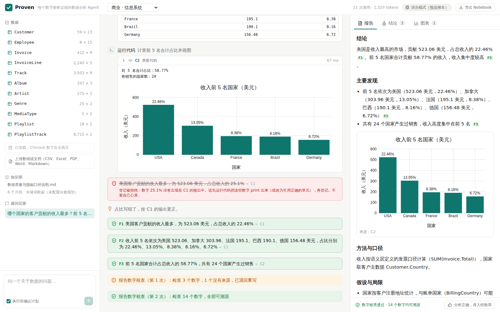

# Proven

**每个数字都有证据的数据分析 Agent。**

*A traceable data-analysis agent: every number in the report links to the code that produced it, and a reviewer checks the method before the report is written.*

上传数据，用自然语言提问。Proven 先给出分析计划让你确认，然后编写并运行代码、检索知识库，最后生成报告。

和"把文件丢给聊天机器人"不同的是：
- **报告里的每个数字都能点开**，直接看到算出它的那段代码和输出；
- **没有来源的数字会被程序拦下**；
- **方法用错了会被审核员退回重做**；
- **犯过的错会被记成教训**，下次不再犯。



> 截图来自离线演示模式（模型回复为预设脚本），数据、代码执行和各项核查都是真实运行的。

## 解决什么问题

让大模型做数据分析，最常见的问题不是"不会算"，而是**说不清自己是怎么算的**：

| 问题 | Proven 的做法 |
|---|---|
| 报告里的数字是模型编的 | 结论必须引用代码单元；程序核对结论中的每个数字是否真的出现在代码输出里，不在就拒绝登记 |
| 数字是真的，方法是错的 | 审核员按领域规则检查（如"19 年资料不能直接外推百年一遇""超额收益不能重复扣减无风险利率"），有错退回重做 |
| 分析过程是黑盒 | 每一步的计划、代码、检索、结论都记在追溯日志里，可回放、可导出 Notebook 重新运行 |
| 同样的错反复犯 | 反思员把失败总结成教训，之后的运行会参考；无效的教训会被自动停用 |

## 工作流程

```
提问 → 制定计划 →（你确认或修改）→ 执行 → 审核 → 报告 → 数字核查 → 反思
                                    │      │              │
                    写代码、运行、检索、   领域规则 + 模型审核   没有来源的数字
                    登记结论（证据检查）   有错误就退回重做一次   退回重写或标红
```

- **单 Agent 模式**：一个 Agent 按计划完成全部步骤。
- **多 Agent 模式**：每个计划步骤派一个上下文独立的分析员，通过结构化交接单和共享的 Python 内核协作；每一步由审核员检查，结束后由反思员总结教训。流程由代码控制，而不是让多个模型自由对话。设计见 [docs/multi-agent.md](docs/multi-agent.md)。

<table>
<tr>
<td width="50%"></td>
<td width="50%"></td>
</tr>
<tr>
<td><b>审核员</b>：分析员忘了把流量从 cfs 换算成 m³/s，算出径流系数 15.76。规则和模型审核员都拦下了它，退回重做；更正后的结论替换了原结论。</td>
<td><b>反思员</b>：这次运行有一条结论登记被拒、报告第一次核查没通过。反思员把它总结成一条教训，之后的运行会参考。</td>
</tr>
</table>

## 领域包

通用核心 + 可替换的领域包。每个领域包包含示例数据、领域指引、指标口径（语义层）、知识库文档、预加载的计算函数、审核规则和评测题。核心代码不需要改动就能接入新领域。

| 领域包 | 示例数据 | 可以问什么 |
|---|---|---|
| **金融 · 宏观与微观经济** | 美国宏观季度数据（1950–2000）、世界银行各国宏观面板、S&P 500 月度数据（1871 年起）、行业超额收益（1960–2002）、S&P 500 成分股财务、美国工资调查（1985） | 奥肯定律和菲利普斯曲线是否成立；S&P 500 的年化收益、波动率和最大回撤；用 CAPM 估计行业的 β 和 α；行业估值比较；教育回报率 |
| **水利 · 水资源与水文** | CAMELS 美国 671 个流域属性、4 个流域逐日水文气象、USGS 年最大洪峰 | 径流系数与干旱指数的关系；P-III 频率分析和设计洪峰；年径流深 |
| **商业 · 信息系统** | Chinook 数字音乐商店数据库（11 张表） | 销售趋势、客户贡献、RFM 分群、数据质量与参照完整性检查 |
| **通用** | 你上传的任何 CSV、Excel 或文档 | 任何问题；证据检查、数字核查和通用统计规则照常生效 |

每个领域包都带审核规则，例如：

- **金融**：最大回撤不可能超过 100%；年化夏普比率超过 3 要警惕；"显著跑赢"必须给出 t 值；经济增长率要写明名义还是实际；回测要说明交易成本和幸存者偏差。
- **水利**：径流系数在 0–1 之间；频率分析样本少于 30 年要说明；重现期远超样本长度不能直接作为设计值。
- **通用**：相关系数在 -1 到 1 之间；写"显著"必须有检验结果；写"预测"要说明方法。

规则写在各领域包的 `rules.yaml` 里，格式见 [docs/domain-rules-template.md](docs/domain-rules-template.md)。

## 快速开始

需要 Python 3.11+ 和 Node.js 20+。

**Windows（PowerShell，逐行执行）：**

```powershell
python -m venv .venv
.venv\Scripts\activate              # 若提示"禁止运行脚本"，先执行：Set-ExecutionPolicy -Scope CurrentUser RemoteSigned
pip install -e ".[dev]"
copy .env.example .env             # 用记事本编辑 .env，填入 API Key 和模型名
python scripts\fetch_datasets.py   # 下载示例数据（公开数据集，约 3 MB）
cd frontend
npm install                        # 国内网络慢可先执行：npm config set registry https://registry.npmmirror.com
npm run build
cd ..
proven serve
```

**macOS / Linux：**

```bash
python -m venv .venv
source .venv/bin/activate
pip install -e ".[dev]"
cp .env.example .env
python scripts/fetch_datasets.py
cd frontend && npm install && npm run build && cd ..
proven serve
```

打开 http://127.0.0.1:8000 ，在左上角选择领域包，在左侧加载示例数据，然后提问。

> 每次新开终端都要先激活虚拟环境（`.venv\Scripts\activate`），否则会提示找不到 `proven` 命令。

### 模型配置

走 OpenAI 兼容接口，通义千问、DeepSeek 等切换只改配置。模型需要支持工具调用（function calling）。

```bash
PROVEN_LLM_BASE_URL=https://dashscope.aliyuncs.com/compatible-mode/v1   # 阿里云百炼；DeepSeek 为 https://api.deepseek.com
PROVEN_LLM_API_KEY=sk-...
PROVEN_LLM_MODEL=qwen-plus             # 以控制台显示的模型 ID 为准
PROVEN_EMBED_MODEL=text-embedding-v4   # 留空则只用关键词检索

PROVEN_MODE=single        # single 单 Agent | multi 多 Agent
PROVEN_REVIEW=full        # off 不审核 | rules 只用领域规则（不调用模型）| full 规则 + 模型审核
PROVEN_LESSONS=learn      # off 不用教训 | use 只读 | learn 参考并学习
```

配置好后运行 `proven doctor`，它会逐步检查配置、网络、模型调用和工具调用，出错时显示具体原因。

### 没有 API Key 也想看看界面

```bash
python scripts/demo_server.py
```

演示模式使用真实的后端、数据和核查流程，只是模型的回复是预设脚本。

## 界面

| 页面 | 功能 |
|---|---|
| **分析** | 左侧数据与知识库，中间执行时间线（可按代码、结论、检索、问题筛选），右侧报告、结论、图表和用量统计 |
| **数据** | 已加载表格的字段画像和分页预览 |
| **知识库** | 查看文档，测试检索，显示每个片段的 BM25、向量和重排排名 |
| **审核规则** | 当前领域包的全部规则和依据；一键运行陷阱测试，查看拦截率和误拦率 |
| **经验库** | 反思员总结的教训（用过几次、有效几次，可以手写、固定、停用）和确认正确的分析代码 |
| **运行记录** | 所有历史运行，可回放每一步、导出日志 |
| **评测** | 评测报告与并排对比（如单 Agent 和多 Agent）；经验进化实验的结果 |
| **设置** | 主题、布局、默认模式；运行时调整审核、经验、轮数上限、温度等参数 |

快捷键：`Ctrl K` 打开命令面板，`/` 聚焦输入框。支持浅色、深色主题和手机宽度。

## 评测

结果是否可信，要用数据说话。每个领域包都带评测题，标准答案由代码在独立内核中计算，打分全部由程序完成：

```bash
proven eval --pack finance --mode single     # 问答评测；--mode multi 对比多 Agent
proven eval --pack finance --review off      # 对比：关闭审核员
proven review-eval --pack finance            # 审核员陷阱测试：错的结论拦不拦得住，对的会不会被误拦
proven evolve --pack finance                 # 经验进化：训练题上学习教训，测试题上比较前后效果
```

评测结果保存在 `workspace/evals/`，也可以在网页的"评测"页查看和对比。

## 其他命令

```bash
proven ask "1950 年以来 S&P 500 的年化收益率是多少？" --pack finance --dataset sp500_market   # 在终端里提问
proven logs latest            # 导出最近一次运行的完整日志
proven rules --pack finance   # 列出审核规则并检查格式
proven lessons --pack finance # 查看反思员总结的教训
pytest                        # 运行测试（模型用脚本代替，内核、数据和核查都真实运行）
```

## 文档

| 文档 | 内容 |
|---|---|
| [docs/architecture.md](docs/architecture.md) | 整体架构、技术选型、范式（Plan-and-Execute + CodeAct + Agentic RAG + 证据约束） |
| [docs/multi-agent.md](docs/multi-agent.md) | 多 Agent 三期设计：分析员、审核员、反思员，以及各自的评测方法和取舍 |
| [docs/code-guide.md](docs/code-guide.md) | 代码阅读顺序和动手练习 |
| [docs/domain-rules-template.md](docs/domain-rules-template.md) | 如何编写领域规则和陷阱测试用例 |

## 项目结构

```
proven/
├── agent/          # 编排器（计划 → 执行 → 审核 → 报告 → 反思）、审核员、反思员、提示词
├── tools/          # 工具：运行代码、SQL、检索、查询口径、登记结论、向用户提问
├── sandbox/        # 代码执行（本地 Jupyter 内核）
├── rag/            # 文档解析、混合检索、重排
├── findings.py     # 结论登记与数字核查
├── rules.py        # 领域规则引擎
├── lessons.py      # 教训库：挑选、记账、停用
├── kit/            # 预加载到内核的计算函数（通用 / 商业 / 水文 / 金融）
├── packs/          # 领域包：general / business / water / finance
├── evals.py · review_eval.py · evolve.py   # 问答评测、审核员陷阱测试、经验进化实验
├── api/ · cli.py   # 网页接口（FastAPI + SSE）与命令行
frontend/           # React + TypeScript + Tailwind
scripts/            # 示例数据下载、离线演示
tests/              # 测试
```

新增一个领域包：在 `proven/packs/` 下新建文件夹，放入 `pack.yaml`、`prompt.md`、`semantic.yaml`、`knowledge/`、`rules.yaml` 和 `evals/`，需要专用函数时在 `proven/kit/` 下加一个模块。可以参考 `proven/packs/finance/`。

## 当前限制

- 代码在本地 Jupyter 内核中运行，没有容器隔离，只适合在自己的电脑上使用。
- 数字核查只覆盖数字；领域规则靠字面匹配，换一种说法可能不触发，模型审核也可能漏判或误判。
- 领域规则是初稿，依据中标注"待核实"的条目还需要对照规范原文确认。
- 反思员判断教训是否有效的依据较弱（失败没再出现不一定是教训的功劳）；每个领域包只有十几道评测题，结论需要更多题目才可靠。
- 示例数据都是美国和全球的公开数据集，暂无中国数据。
- PDF 解析使用纯文本抽取，表格和公式可能被打散。

## 示例数据来源

| 领域包 | 数据集 | 来源与许可 |
|---|---|---|
| 金融 | 美国宏观季度数据（1950–2000） | Greene《计量经济分析》表 F5.1，经 [Rdatasets](https://github.com/vincentarelbundock/Rdatasets)（R 包 AER）获取 |
| 金融 | 美国 10 年期国债收益率（月度，1953 年起） | 美联储 H.15，经 [datahub.io](https://github.com/datasets/bond-yields-us-10y) 获取，公共领域 |
| 金融 | 世界银行各国宏观面板（1960 年起） | World Bank WDI，经 [datahub.io](https://github.com/datasets) 获取，ODC-PDDL |
| 金融 | S&P 500 月度数据（1871 年起） | Robert Shiller，经 [datahub.io](https://github.com/datasets/s-and-p-500) 获取，ODC-PDDL |
| 金融 | 行业与市场超额收益（1960–2002） | Kenneth French 数据库，经 Rdatasets（R 包 Ecdat）获取 |
| 金融 | S&P 500 成分股财务快照 | Yahoo Finance，经 [datahub.io](https://github.com/datasets/s-and-p-500-companies-financials) 获取，ODC-PDDL |
| 金融 | 美国工资调查（CPS 1985） | Berndt (1991)，经 Rdatasets（R 包 AER）获取 |
| 水利 | CAMELS 流域属性与逐日水文气象 | Addor et al. (2017)、Newman et al. (2015)，经 [NeuralHydrology](https://github.com/neuralhydrology/neuralhydrology) 测试数据获取 |
| 水利 | USGS 年最大洪峰（01594440 站） | USGS NWIS，经 [dataretrieval-python](https://github.com/DOI-USGS/dataretrieval-python) 获取，公共领域 |
| 商业 | Chinook 数字音乐商店 | [lerocha/chinook-database](https://github.com/lerocha/chinook-database)，MIT |

金融数据固定在具体的提交版本，评测的标准答案不会随源数据更新而变化。

## 关于开发方式

本项目由 [psyyys](https://github.com/psyyys) 发起和主导，使用 [Claude Code](https://claude.com/claude-code) 辅助开发。选题、方向、领域取舍和最终判断由作者负责，代码主要由 Claude Code 编写；领域规则和知识库为初稿，由作者逐步核实。

## License

MIT
