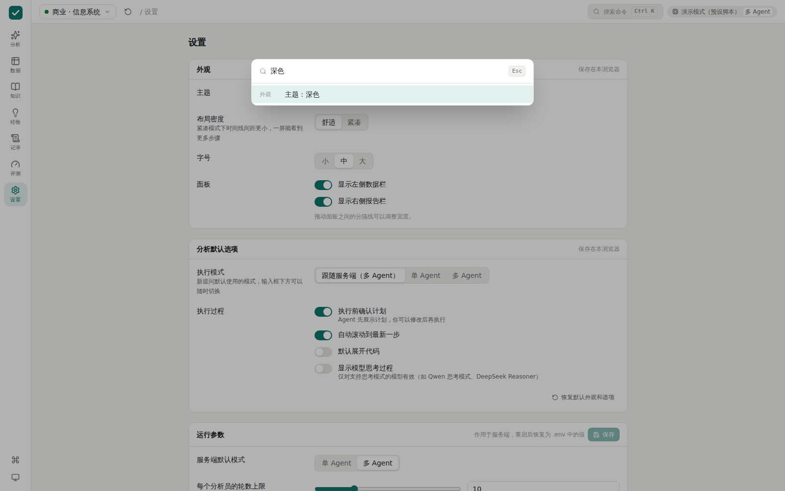

# Proven

**每个数字都有证据的数据分析 Agent。**

上传数据、用自然语言提问，Proven 会制定计划、编写并运行代码、检索知识库，最后生成分析报告。和"把文件丢给聊天机器人"不同的是：**报告里的每一个数字都能点开，看到产生它的那段代码和输出；没有来源的数字会被程序拦下来。**


> 截图来自离线演示模式（模型回复为预设脚本），数据、代码执行和核查都是真实运行的。

## 核心特点

| 能力 | 说明 |
|---|---|
| **结论登记** | Agent 得出关键数字时必须登记结论并引用代码单元。登记时程序会检查：结论里的每个数字都必须出现在该单元的输出中，否则拒绝 |
| **报告核查** | 报告写完后，程序扫描所有数字，逐一比对已登记的结论。没有来源的数字会被退回重写，仍然通不过的在界面上标红 |
| **点击溯源** | 报告中的 `F1`、`F2` 标记可以点击，直接跳转到证据代码或文档原文 |
| **计划可编辑** | 执行前先展示分析计划，你可以修改、删除、添加步骤后再执行 |
| **语义层** | 每个数据集配有数据字典和指标口径（如"客单价"怎么算），Agent 先查口径再计算 |
| **混合检索 RAG** | BM25（jieba 中文分词）+ 向量检索，RRF 融合，可选重排模型；每段原文有编号，可作为证据 |
| **经验库** | 你确认正确的分析会存下来，下次遇到相似问题时作为参考 |
| **可复现** | 整个分析可导出为 Jupyter Notebook，任何人都能重新运行 |
| **领域插件** | 通用核心 + 可替换的领域包。目前有：通用、商业·信息系统、水利·水资源与水文 |
| **评测体系** | 每个领域包带测试题，自动计算标准答案并打分，可对比不同模型 |
| **多 Agent 模式** | 可选：每个计划步骤派一个上下文独立的分析员，通过结构化交接单和共享内核协作，减少上下文膨胀；可与单 Agent 模式在评测集上对比。见 [docs/multi-agent.md](docs/multi-agent.md) |
| **模型无关** | 走 OpenAI 兼容接口，通义千问、DeepSeek 等切换只改配置 |

## 界面

| 页面 | 功能 |
|---|---|
| **分析** | 三栏工作区：左侧数据与知识库（支持拖入文件），中间执行时间线，右侧报告。时间线可按代码、结论、检索、问题筛选，一键展开或收起全部代码；多 Agent 模式下有步骤导航。报告支持复制和下载，"用量"页显示各步骤的 Token 与工具调用统计。两侧面板可拖动调宽、可隐藏 |
| **数据** | 浏览已加载的表：字段画像（类型、缺失、唯一值、分布）和分页数据预览 |
| **知识库** | 查看文档，直接测试检索，显示每个片段的 BM25、向量和重排排名 |
| **经验库** | 查看、搜索、删除已验证的分析经验 |
| **运行记录** | 所有历史运行（包括以前启动服务时的），可搜索、筛选、回放每一步、导出日志 |
| **评测** | 查看评测报告；勾选两份报告并排对比，如单 Agent 和多 Agent |
| **设置** | 主题（浅色、深色、跟随系统）、布局密度、字号；默认执行模式、是否确认计划、是否显示模型思考过程；运行时调整服务端参数（轮数上限、温度、输出上限、超时） |

快捷键：`Ctrl K` 打开命令面板，`/` 聚焦输入框。界面适配手机宽度。



## 快速开始

需要 Python 3.11+ 和 Node.js 20+。

**macOS / Linux：**

```bash
python -m venv .venv
source .venv/bin/activate
pip install -e ".[dev]"
cp .env.example .env               # 编辑 .env，填入 API Key 和模型名
python scripts/fetch_datasets.py   # 下载示例数据（公开数据集，约 10 MB）
cd frontend && npm install && npm run build && cd ..
proven serve
```

**Windows（PowerShell，逐行执行）：**

```powershell
python -m venv .venv
.venv\Scripts\Activate.ps1          # 若提示"禁止运行脚本"，先执行：Set-ExecutionPolicy -Scope CurrentUser RemoteSigned
pip install -e ".[dev]"
copy .env.example .env             # 用记事本编辑 .env，填入 API Key 和模型名
python scripts\fetch_datasets.py
cd frontend
npm install                        # 国内网络慢可先执行：npm config set registry https://registry.npmmirror.com
npm run build
cd ..
proven serve
```

打开 http://127.0.0.1:8000 ，在左侧加载示例数据，然后提问。

### 模型配置

`.env` 中的关键项：

```bash
PROVEN_LLM_BASE_URL=https://dashscope.aliyuncs.com/compatible-mode/v1   # 阿里云百炼
PROVEN_LLM_API_KEY=sk-...
PROVEN_LLM_MODEL=qwen-plus          # 换成你要用的模型 ID（以百炼控制台显示的为准）
PROVEN_EMBED_MODEL=text-embedding-v4   # 留空则只用关键词检索
# PROVEN_RERANK_MODEL=gte-rerank-v2    # 可选
```

配置好后可以运行 `proven doctor` 检查：它会逐步检查配置、代理、域名解析、模型调用和工具调用，出错时显示具体原因。

用 DeepSeek 官方接口时，把地址改成 `https://api.deepseek.com`，模型改成对应的模型 ID 即可。模型需要支持工具调用（function calling）。

### 没有 API Key 也想看看界面

```bash
python scripts/demo_server.py
```

这个演示模式使用真实的后端、数据和核查流程，只是模型的回复是预设脚本（无论问什么，都会回放同一个分析）。

## 其他用法

```bash
# 在终端里提问
proven ask "2021-2025 年每年的销售额是多少？" --pack business --dataset chinook

# 跑评测（结果保存在 workspace/evals/）
proven eval --pack business
proven eval --pack water --mode multi      # 多 Agent 模式，可与 --mode single 对比
proven eval --pack water --only w08 w09 w10

# 只计算标准答案，不调用模型
proven eval --pack water --references-only

# 运行测试
pytest

# 前端开发模式（热更新，接口转发到 8000 端口）
proven serve &
cd frontend && npm run dev
```

## 工作流程

```
提问 → 数据画像 → 制定计划 →（你确认/修改）→ 执行循环 → 报告 → 数字核查 →（不通过则重写）→ 完成
                                         │
                       思考 → 调用工具 → 观察结果 → 出错自修
                       工具：run_python · query_sql · inspect_data · lookup_semantic
                             search_knowledge · recall_experience · record_finding · ask_user
```

详细设计见 [docs/architecture.md](docs/architecture.md)，代码阅读顺序见 [docs/code-guide.md](docs/code-guide.md)。

## 项目结构

```
proven/
├── agent/          # 编排器（计划→执行→报告→核查）、会话、提示词
├── llm.py          # 模型适配器（OpenAI 兼容接口）
├── tools/          # 工具注册表与内置工具
├── sandbox/        # 代码执行器接口 + 本地 Jupyter 内核实现
├── rag/            # 文档解析、切块、混合检索、重排
├── findings.py     # 结论登记与数字核查（防幻觉）
├── semantic.py     # 语义层
├── experience.py   # 经验库
├── trace.py        # 追溯日志（SQLite，可导出 OpenTelemetry 格式）
├── kit/            # 预加载到内核的辅助函数（通用 / 商业 / 水文）
├── packs/          # 领域包
├── evals.py        # 评测
├── notebook.py     # Notebook 导出
├── api/            # FastAPI + SSE
└── cli.py          # 命令行
frontend/src/
├── app/            # 应用外壳、导航、命令面板、全局状态
├── ui/             # 通用组件（按钮、标签页、开关、弹窗、提示等）
├── lib/            # 接口、类型、事件到界面状态的推导、偏好设置
└── features/       # 各页面：analysis / data / knowledge / experience / history / evals / settings
scripts/            # 数据下载、离线演示
tests/              # 测试（模型用脚本代替，内核、数据、核查都真实运行）
```

## 新增一个领域包

在 `proven/packs/` 下新建文件夹：

```
proven/packs/your_domain/
├── pack.yaml          # 名称、描述、示例数据集、示例问题、内核辅助模块
├── prompt.md          # 领域指引：术语、分析习惯、注意事项
├── semantic.yaml      # 数据字典、表关系、指标口径
├── knowledge/         # 知识库文档（md / pdf / docx）
└── evals/questions.yaml   # 测试题
```

如需领域专用函数，在 `proven/kit/` 下新建模块，并在 `pack.yaml` 中用 `kit:` 指定，它会被预加载到内核里。核心代码不需要改动。

## 示例数据

| 领域包 | 数据集 | 来源与许可 |
|---|---|---|
| 商业 | Chinook 数字音乐商店（11 张表） | [lerocha/chinook-database](https://github.com/lerocha/chinook-database)，MIT |
| 水利 | CAMELS 流域属性（671 个流域） | Addor et al. (2017)，经 [NeuralHydrology](https://github.com/neuralhydrology/neuralhydrology) 测试数据获取 |
| 水利 | CAMELS 逐日水文气象（4 个流域，2000-2002） | Newman et al. (2015)，同上 |
| 水利 | USGS 年最大洪峰（01594440 站，2000-2018） | USGS NWIS，经 [dataretrieval-python](https://github.com/DOI-USGS/dataretrieval-python) 测试数据获取，公共领域 |

`python scripts/fetch_datasets.py --usgs-site 01646500` 可以直接从 USGS 下载其他站点更长的洪峰序列。

## 当前限制

- 代码在本地 Jupyter 内核中运行，没有容器隔离，只适合在自己的电脑上使用。公开部署前需要换成 Docker 执行器
- PDF 解析使用纯文本抽取，表格和公式可能被打散；计划升级为版面感知解析（MinerU / Docling）
- 数字核查只覆盖数字，不能判断文字结论的逻辑是否正确
- 多 Agent 模式已实现第 1 期（分析员子代理）；审核员（领域规则校验）和反思员（经验进化）为设计稿，见 [docs/multi-agent.md](docs/multi-agent.md)

## License

MIT
