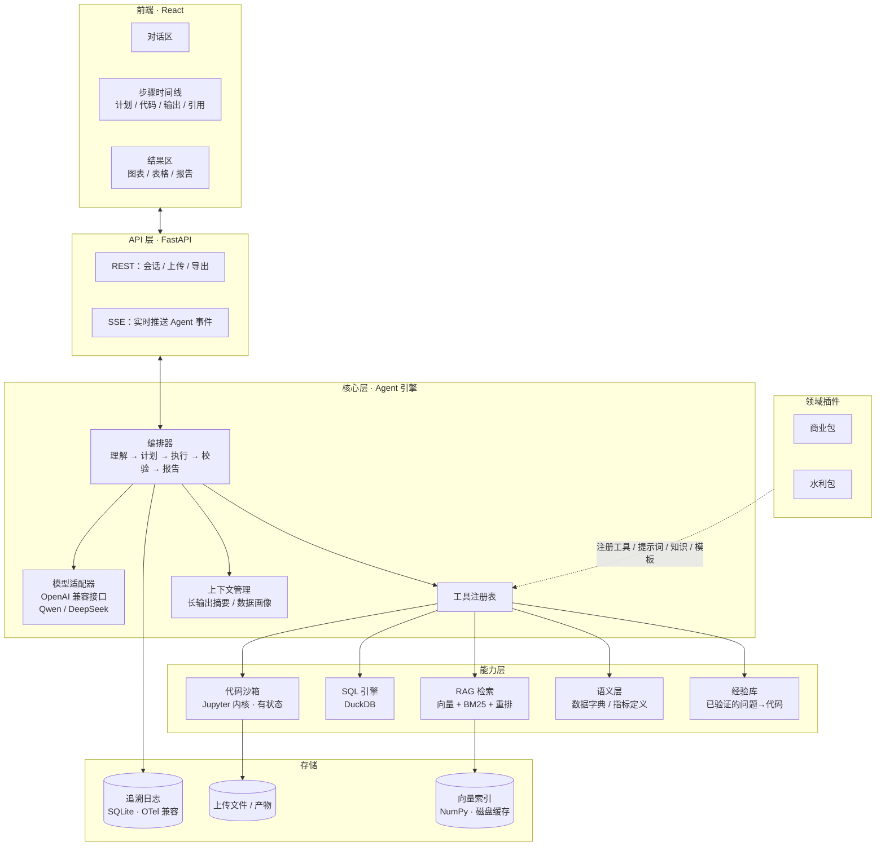
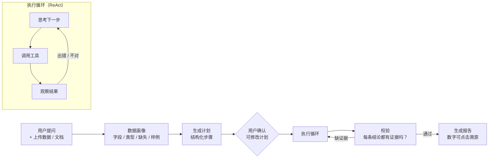

# 架构设计（v0.4）

> 状态：第一版已实现。项目名：**Proven**。本文档描述当前实现；与原计划不同的地方在第 17 节列出。

## 范式

一句话：**Plan-and-Execute + CodeAct 式 ReAct + 工具化 RAG + 证据约束与程序化核验**。

| 层 | 范式 | 一句话解释 | 代码 |
|---|---|---|---|
| ① 规划 | Plan-and-Execute | 先列计划给人确认，再执行 | `agent/orchestrator.py` `_plan()` |
| ② 执行 | ReAct | 思考 → 调工具 → 看结果，循环 | `agent/orchestrator.py` `_execute()` |
| ③ 动作 | CodeAct | 模型的主要动作是写 Python 代码并运行（Wang et al., 2024, *Executable Code Actions Elicit Better LLM Agents*） | `sandbox/`、`tools/builtin.py` `run_python()` |
| ④ 知识 | Agentic RAG | 模型需要时自己调用检索，而不是每次都先检索 | `rag/`、`tools/builtin.py` `search_knowledge()` |
| ⑤ 防编造 | 证据约束 + 程序化核验 | 结论必须绑定证据；由程序而不是模型核对报告里的每个数字 | `findings.py`、`tools/builtin.py` `record_finding()` |

①–④ 是业界常见做法，⑤ 是本项目的特色。工具调用的底层机制是 Function Calling（用 JSON Schema 描述工具）。

多 Agent 模式只替换第 ② 层：Orchestrator-Workers（调度器按计划逐步派出上下文独立的分析员，第 1 期已实现）+ Reflection（审核员按领域规则和方法要点检查，第 2 期已实现）+ Reflexion（反思员从失败中总结经验，第 3 期）。流程由代码控制而不是模型自由对话，①③④⑤ 不变。详见 [multi-agent.md](multi-agent.md)。

审核员同样适用于单 Agent 模式（执行结束后审核一次），它把第 ⑤ 层从"数字有没有来源"扩展到"方法和表述站不站得住"：

| 层次 | 检查什么 | 谁检查 | 代码 |
|---|---|---|---|
| 证据检查 | 结论里的数字是否出现在所引用代码的输出中 | 程序 | `findings.py` `unsupported_numbers()` |
| 领域规则 | 取值范围、方法适用条件、文字与数字一致 | 程序（规则由领域专家编写） | `rules.py`、`packs/*/rules.yaml` |
| 模型审核 | 规则写不出来的方法问题 | 模型（审核员角色） | `agent/review.py` |
| 报告核查 | 报告里的每个数字是否对应已登记的结论 | 程序 | `findings.py` `check_report()` |

代码阅读顺序见 [code-guide.md](code-guide.md)。

## 1. 定位

一个**可追溯的数据分析型 Agent**，带 RAG 能力，网页交互。

- 通用核心 + 领域插件：先做通用底座，再通过插件适配不同专业方向
- 第一批插件：**商业（信息系统方向）**、**水利（水资源 / 水文方向）**
- 核心原则：**结论里的每个数字都必须来自真实运行的代码，每条知识都必须来自可引用的原文**，不允许黑盒

申请方向优先级：商业分析 > 水利 > HCI（HCI 暂不做用户研究，但交互要做好）。

## 2. 总体架构



## 3. 技术选型

| 部分 | 选择 | 理由 | 放弃的方案 |
|---|---|---|---|
| 语言 | Python 3.11+ | 数据分析生态最好 | — |
| Agent 核心 | **自研**（不用框架） | 追溯需要完全控制每一步；代码量小，便于理解和改造 | LangChain（抽象太厚，事件难以完整追溯） |
| 模型接入 | `openai` SDK + OpenAI 兼容接口 | 百炼、DeepSeek 都兼容，换模型只改配置 | 各家专用 SDK |
| 代码执行 | 执行器接口 + 第一版实现：本地 Jupyter 内核（`jupyter_client`），带超时 / 资源限制 | 有状态：变量跨步骤保留；每个代码单元天然就是一条追溯记录。抽象成接口，后续可换 Docker / E2B（参考 smolagents、TaskWeaver） | 每次起新进程（丢状态）；直接上 Docker（第一版太重） |
| 数据查询 | pandas + **DuckDB** | DuckDB 直接用 SQL 查 CSV/Excel/Parquet，处理大文件快；SQL 是信息系统方向的加分项 | 只用 pandas |
| RAG | 向量（NumPy 余弦相似度，Embedding 按内容哈希缓存）+ BM25（jieba 中文分词）+ RRF 融合 + 重排模型 | 混合检索对中文专业术语更准，可以展示检索技术；每段原文有 ID，可引用。单机几万段以内 NumPy 足够，少一个重依赖 | Chroma（依赖较重，规模大了再换）；只用向量检索 |
| 文档解析 | 第一版：pypdf / python-docx 文本抽取 + 按标题和句子切块；计划升级为版面感知解析（MinerU / Docling） | 规范、年报里大量表格和公式，解析质量决定 RAG 上限（参考 RAGFlow 的 DeepDoc） | — |
| Embedding / 重排 | 百炼 text-embedding、gte-rerank | 和你已有的 API 套餐一致 | — |
| 后端 | FastAPI + SSE | 流式推送每一步事件，前端实时显示 | WebSocket（第一版不需要双向） |
| 前端 | **React + Vite + Tailwind + shadcn/ui** | 你在意交互，这是自由度最高的方案 | Streamlit / Gradio（快，但交互定制能力弱，做不出时间线和可点击溯源） |
| 图表 | Plotly | Agent 生成图表 JSON，前端渲染成可交互图表 | matplotlib 静态图 |
| 存储 | SQLite + 本地文件 | 零部署，单机即可运行，开源用户上手容易 | PostgreSQL（第一版不需要） |
| 追溯格式 | 自定义事件，字段对齐 OpenTelemetry GenAI 规范 | 自己的前端能用，也能导出到 Langfuse / Phoenix 等标准观测工具（参考 TaskWeaver、Vanna） | 完全自定义格式 |

## 4. Agent 运行流程



1. **数据画像**：自动分析上传的数据，把结构信息（不是全量数据）交给模型，避免撑爆上下文
2. **计划**：模型输出结构化 JSON 计划，前端展示，用户可以修改或直接放行（自动模式）
3. **执行**：ReAct 循环，有最大步数和重试预算；代码报错时把错误信息交还给模型自行修复
4. **校验**：检查每条结论是否都有证据（代码单元或引用原文），缺证据就打回去补
5. **报告**：只能基于已登记的结论来写

## 5. 可追溯机制（核心卖点）

这是本项目区别于"ChatGPT 上传文件分析"的关键。

**① 结论登记制。** Agent 得出关键数字时，必须调用 `record_finding` 工具登记：

```json
{
  "id": "F3",
  "claim": "2023 年 Q4 复购率为 23.4%",
  "value": 0.234,
  "evidence": { "type": "code_cell", "cell_id": "C7" }
}
```

**② 报告防幻觉检查。** 报告生成后，程序扫描报告正文里的所有数字，逐个比对已登记的结论。**找不到来源的数字会被标红或打回重写。** 这一步是程序检查，不依赖模型自觉。

**③ 全链路事件日志。** 每次模型调用、工具调用、代码单元、输出、检索片段都记成一条事件存进 SQLite。前端时间线就是这份日志的可视化。

**④ 可复现导出。** 整个分析过程可以导出成 `.ipynb`，任何人都能重新运行，得到相同的结果。

**⑤ RAG 引用。** 知识类结论标注文档名、页码和原文片段，点击即可查看。

## 6. 语义层与经验库（v0.2 新增）

参考 WrenAI（语义层）和 Vanna（Agent 记忆）：

- **语义层**：每个数据集配一份数据字典，写明字段含义、表之间的关系、指标口径（例如"复购率 = 90 天内下单 ≥2 次的客户 / 总客户"）。Agent 先查语义层再写代码，避免各算各的口径。这是信息系统方向的核心议题，也让 RAG 不止用来查文档，还服务于数据分析本身
- **经验库**：用户确认某次分析正确后，"问题 → 代码"会存进经验库；以后遇到相似问题，先检索已验证的写法作为参考。用得越多越准

## 7. 工具清单（第一版）

| 工具 | 作用 |
|---|---|
| `inspect_data` | 查看数据画像、字段统计 |
| `run_python` | 在沙箱中执行 Python，返回输出 / 图表 / 报错 |
| `query_sql` | 用 DuckDB 执行 SQL |
| `search_knowledge` | RAG 检索，返回带 ID 的原文片段 |
| `lookup_semantic` | 查数据字典 / 指标定义（如"复购率"的口径） |
| `recall_experience` | 检索经验库中相似问题的已验证代码 |
| `record_finding` | 登记结论及其证据 |
| `ask_user` | 遇到歧义时向用户提问，而不是瞎猜 |

领域插件可以注册额外的工具（比如水利包的 `frequency_analysis`）。

## 8. 领域插件结构

每个插件是一个文件夹，内容固定：

```
packs/water/
├── pack.yaml          # 名称、描述、启用的工具
├── prompt.md          # 领域提示词：术语、分析习惯、注意事项
├── tools.py           # 领域专用工具（Python 函数 + 参数说明）
├── knowledge/         # RAG 文档（规范、手册；注意版权，不随开源发布）
├── semantic.yaml      # 语义层：数据字典、指标定义、业务术语
├── templates/         # 报告模板
├── datasets.yaml      # 示例数据集及下载方式
└── evals/             # 该领域的测试题
```

新增一个专业方向 = 新建一个插件文件夹，核心代码不需要改动。

## 9. 前端交互设计

三栏布局：

```
┌────────────┬─────────────────────┬──────────────────────┐
│  对话区     │   步骤时间线          │   结果区              │
│            │                     │                      │
│  提问       │  ✓ 计划（可编辑）     │  [图表] [表格] [报告]  │
│  上传文件    │  ✓ 步骤1 查看数据     │                      │
│  确认计划    │    ▸ 代码（可展开）   │  报告中的数字可点击 →  │
│            │  ⟳ 步骤2 计算复购率   │  跳转到时间线中对应的   │
│            │    ▸ 输出            │  代码单元              │
│            │  ○ 步骤3 …           │                      │
└────────────┴─────────────────────┴──────────────────────┘
```

交互要点：实时流式显示、可中途暂停或改方向、计划可编辑、数字与代码双向跳转、引用悬停预览原文。

## 10. 评测体系

- 测试题用公开数据集出题，标准答案由参考代码计算，自动判分（数值允许误差）
- 六类题型：基础查询、聚合对比、多步推理、领域计算、陷阱题（应拒答）、RAG 引用题
- 指标：答案正确率、陷阱题拒答率、报错后自修成功率、引用正确率、平均步数 / Token 消耗
- 同一套题分别在 Qwen / DeepSeek 上跑，生成对比表，放进 README

## 11. 候选公开数据集

| 领域 | 数据集 | 用途 |
|---|---|---|
| 商业 | Chinook 数字音乐商店（11 张表，MIT） | 信息系统方向：多表 SQL、数据质量、RFM |
| 水利 | CAMELS 流域属性（671 个流域） | 流域特征对比、相关分析 |
| 水利 | CAMELS 逐日水文气象（4 个流域，2000-2002） | 径流深、径流系数、降雨径流 |
| 水利 | USGS 年最大洪峰（01594440 站，2000-2018） | P-III 洪水频率分析 |
| 两者 | 项目自编的方法说明文档 | RAG 知识库（正式规范有版权，不随项目发布） |

原计划的 Olist、UCI 数据集需要登录或无稳定下载地址，改用以上可脚本化下载的公开数据。

## 12. 目录结构

```
proven/
├── agent/          # 编排器（计划→执行→报告→核查）、会话、单次运行状态、提示词
├── llm.py          # 模型适配器
├── tools/          # 工具注册表 + 内置工具
├── sandbox/        # 执行器接口 + Jupyter 内核实现
├── rag/            # 解析、切块、混合检索、重排
├── findings.py     # 结论登记、证据检查、报告数字核查
├── semantic.py     # 语义层
├── experience.py   # 经验库
├── trace.py        # 追溯事件（SQLite + 实时订阅 + OTel 导出）
├── kit/            # 预加载到内核的辅助函数：core / business / water
├── packs/          # 领域包：general / business / water（测试题在各包的 evals/ 下）
├── evals.py        # 评测
├── notebook.py     # Notebook 导出
├── service.py      # 会话与运行管理（API、CLI、评测共用）
├── api/            # FastAPI 路由、SSE
└── cli.py          # proven serve / ask / eval
frontend/           # React + Vite + Tailwind
scripts/            # 数据下载、离线演示
tests/              # 测试
```

## 13. 第一版范围

**做：** 上传数据 + 文档 → 计划 → 执行 → 校验 → 可溯源报告；RAG；三栏网页界面；商业和水利两个插件各带示例数据和测试题；Qwen / DeepSeek 切换；`.ipynb` 导出。

**验收标准：**
1. 测试集正确率达到预设目标（建好测试集后再定具体数值）
2. 报告中 100% 的数字可溯源（由防幻觉检查保证）
3. 陷阱题能拒答，而不是编造
4. 代码报错能自行修复
5. 两个模型都能通过测试

**不做（第二版及以后）：** 多 Agent 协作、用户账号、线上部署、Docker 沙箱、数据库直连、MCP 支持（让插件可以是 MCP 服务，也让本 Agent 作为 MCP 服务被其他工具调用）。

## 14. 参考项目调研

| 项目 | 定位 | Agent 核心 | 值得借鉴 |
|---|---|---|---|
| RAGFlow | RAG 引擎 | 自研（大量重写为 Go） | 版面感知文档解析；引用溯源 |
| PandasAI | 对话式数据分析 | 自研，DuckDB + sqlglot | 沙箱执行 LLM 生成的代码 |
| Vanna 2.0 | 自然语言查数据库 | 自研；LangChain 仅出现在旧版代码中 | 审计 / 观测模块；经验记忆 |
| DB-GPT | 数据 + RAG + Agent 平台 | 自研（AWEL 工作流） | Docker 沙箱；模块化包结构 |
| WrenAI | 生成式 BI | 自研语义层；LangChain / PydanticAI 仅作为对外集成 SDK | 语义层；评测目录 |
| TaskWeaver（微软） | 数据分析 Agent | 自研：Planner + 有状态代码解释器 | 和本项目最像；OpenTelemetry 追溯；自动评测 |
| smolagents（HF） | 极简 Agent 库 | 核心约 1000 行 | 代码即动作；可替换执行器 |

结论：主流数据分析类开源项目的核心都是自研，框架只作为对外集成。本项目保持自研核心。

## 15. 向多 Agent 演进

第 1 期（分析员子代理）已实现，`PROVEN_MODE=multi` 开启；第 2 期审核员已实现，`PROVEN_REVIEW` 控制（off / rules / full，默认 full），单 Agent 和多 Agent 模式都生效；第 3 期反思员为设计稿。完整设计、取舍和评测方法见 [multi-agent.md](multi-agent.md)，领域规则格式见 [domain-rules-template.md](domain-rules-template.md)。

## 16. 待确认

- [x] 水利子方向：水资源 / 水文
- [x] 商业子方向：信息系统
- [x] 项目名称：Proven

## 17. 实现与原计划的差异

| 原计划 | 实际 | 原因 |
|---|---|---|
| 向量库用 Chroma | NumPy + 磁盘缓存，接口不变 | 单机规模够用，少一个重依赖；规模大了可替换 |
| 版面感知 PDF 解析 | 第一版用 pypdf 文本抽取 | 先跑通全流程，解析器升级不影响 Chunk 格式 |
| `make_chart` 工具 | 合并进 `run_python`：图表输出自动捕获 | 少一个工具，模型更少出错；图表照样有单元编号可引用 |
| 领域工具在后端注册 | 领域函数预加载到内核（`proven/kit/`），在代码里调用 | 调用过程本身就是可见、可复现的代码，追溯更完整 |
| Olist / UCI 数据 | Chinook / CAMELS / USGS | 见第 11 节 |

## 18. 核查规则细节

- **数字提取**：识别千分位、小数、科学计数、`%`、`万`、`亿`、`个百分点`；跳过日期（2023年3月、2023-01-05、Q4、年份）、引用标记、列表序号，以及 10 以内的整数（多为序数，如"前 5 名"）
- **匹配**：按书写精度允许四舍五入误差（写 23.4% 可以对应 0.2341 或 23.43）；百分数和小数互相换算
- **登记检查**：结论中的数字必须出现在所引用单元的输出（stdout、表格、文本）或文档片段中
- **报告检查**：报告中的数字必须对应某条已登记结论，或出现在用户问题、计划中；引用的 F 编号必须存在。第一次不通过会把问题列表交给模型重写一次，第二次仍不通过就在界面上标红
