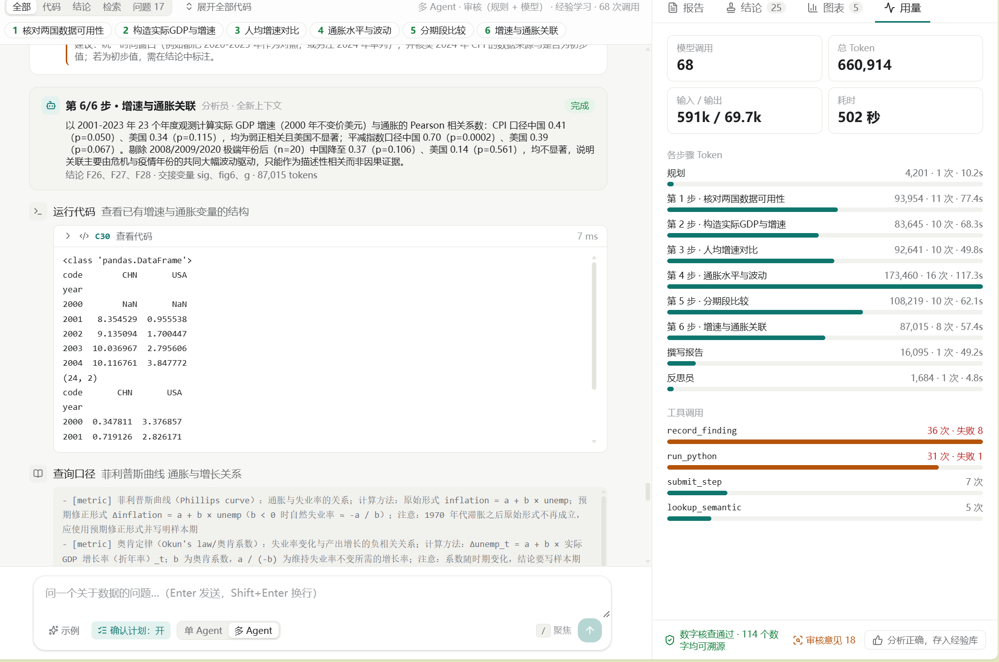
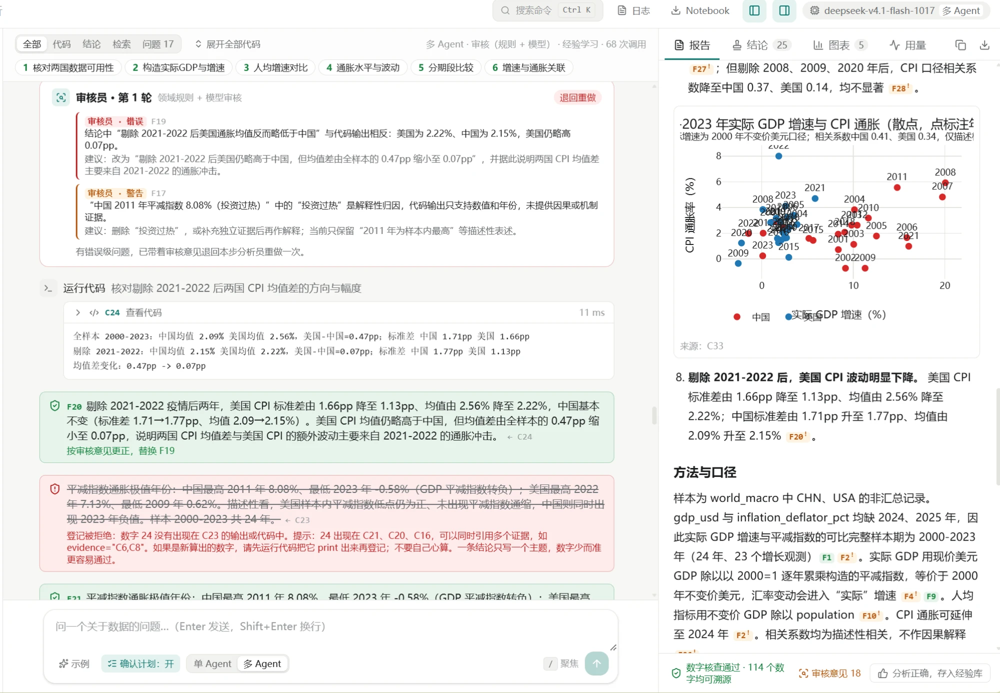
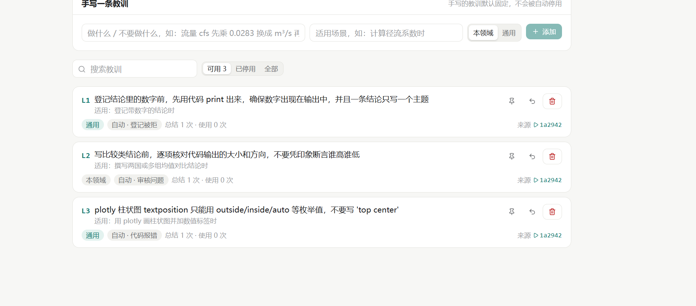

# 真实运行示例：2000 年以来中美 GDP 增速与通胀的差异

这是一次用真实模型完成的完整分析，没有经过任何修改。文件夹里有三份材料：

| 文件 | 内容 |
|---|---|
| [report.md](report.md) | 最终报告：8 条主要发现，114 个数字，每个都标注了来源结论编号 |
| [run-log.md](run-log.md) | 完整运行日志：计划、每一步的代码和输出、每次结论登记（包括被拒的）、审核意见、反思 |
| [analysis.ipynb](analysis.ipynb) | 导出的 Notebook：在项目根目录打开，按顺序运行即可复现报告中的数字（需要先运行 `python scripts/fetch_datasets.py --pack finance` 下载数据） |

## 运行概况

| 项目 | 数值 |
|---|---|
| 问题 | 2000 年以来中国、美国的 GDP 增速和通胀率有什么差异？ |
| 领域包 / 数据 | 金融 · 宏观与微观经济 / 世界银行各国宏观面板（world_macro） |
| 模型 | deepseek-v4.1-flash |
| 设置 | 多 Agent、审核员（领域规则 + 模型审核）、经验学习 |
| 计划 | 6 步：核对数据可用性 → 构造实际 GDP 与增速 → 人均增速对比 → 通胀水平与波动 → 分期段比较 → 增速与通胀关联 |
| 用量 | 模型调用 68 次，Token 660,914（输入 591k / 输出 69.7k），耗时 502 秒 |
| 代码 | 运行代码 31 次，报错 1 次（plotly 参数写错，下一次已改正） |
| 结论 | 登记 28 条，被证据检查拒绝 8 次，审核后替换 3 条，最终 25 条 |
| 报告核查 | 第一次即通过，114 个数字全部可溯源 |
| 审核 | 每步审核共提出 1 个错误、37 条警告；错误退回重做后解决，最终 18 条警告写入报告的"假设与局限" |
| 反思 | 总结 3 条新教训 |

## 值得看的几个地方

### 1. 审核员拦下了一个方向写反的结论

第 4 步，分析员登记了"剔除 2021–2022 年后，美国通胀均值反而略低于中国"。代码输出却是美国 2.22%、中国 2.15%，美国仍略高。数字检查拦不住这种错误，因为每个数字确实都出现在输出里，只是大小关系写反了。

模型审核员指出了这个错误，把这一步退回给同一个分析员。分析员重新核对后登记了更正的结论 F20（"美国 CPI 均值仍略高于中国，但均值差由全样本的 0.47pp 缩小至 0.07pp"），替换了错误的 F19。第 2 轮复审通过。

### 2. 证据检查拦下了"心算"的数字

8 次登记被拒中，有几次是分析员在结论里写了代码没有打印的数字。例如两个均值的差 0.82、1.08，是心算出来的。按规则，这些数字必须先用代码算出来、打印出来，才能登记。被拒后，分析员都补跑了代码再登记。

### 3. 分析员自己标出了口径问题

`world_macro` 里的 GDP 是现价美元。分析员用 GDP 平减指数把它折算成"2000 年不变价美元"，并在结论 F9 和报告的"假设与局限"里写明：这个口径会受汇率变动影响，不等同于官方的本币不变价增速。结论里的"实际增速"始终带着这个限定。

### 4. 反思员总结的教训

运行结束后，反思员读取了这次的失败记录（登记被拒、审核退回、plotly 参数报错），总结了 3 条教训。之后的运行会把相关的教训放进提示词：

## 这次运行暴露的问题（已经或计划改进）

- **"万亿"被误读，导致 2 次误拒（已修复）。** 代码打印了"1.2113 万亿美元"，结论原样引用，却被拒绝：数字解析把"万亿"当成了"万"。现在"万亿"按 10¹² 解析，并且接受代码已经按同一单位打印的数字。
- **Notebook 导出包含本机的绝对路径（已修复）。** 现在导出的数据路径相对于项目根目录，换一台电脑也能运行。本文件夹里的 Notebook 已按这个方式处理。
- **部分审核警告是泛泛而谈。** 例如有一条警告提醒"如果 CPI 来自 Shiller 月度数据，2023 年之后的 0 值会影响结果"，但这次的 CPI 来自世界银行，并没有这个问题。原因是领域包的审核要点按整个领域编写，没有区分具体用的是哪份数据。18 条警告全部写进报告，读起来偏冗长。
- **Token 用量较大。** 第 4 步一步就用了 17 万 Token，其中包括被退回重做的几轮调用。证据检查和审核换来了可靠性，代价是更多的调用。
