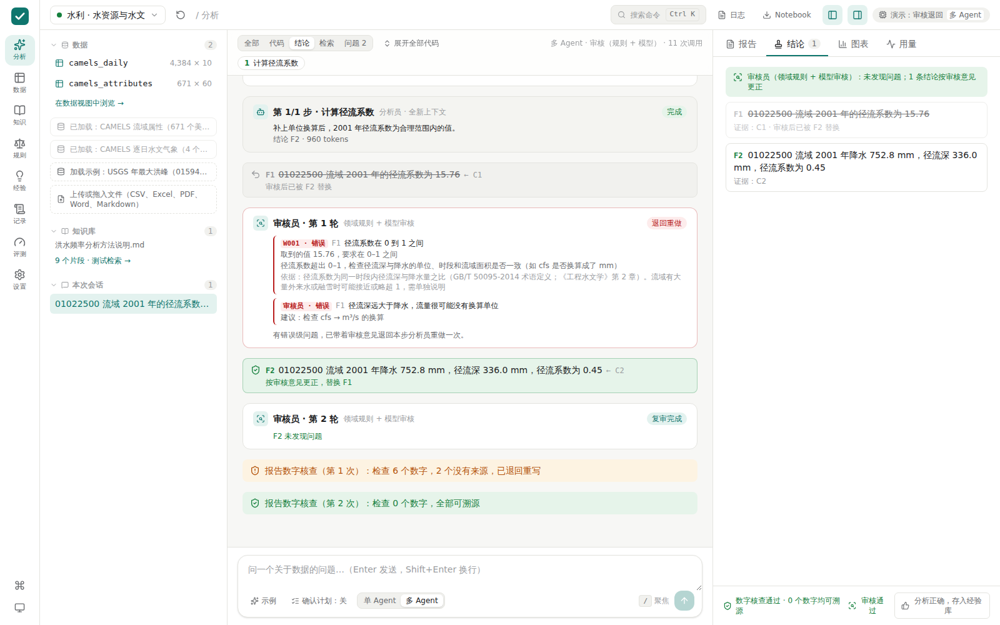
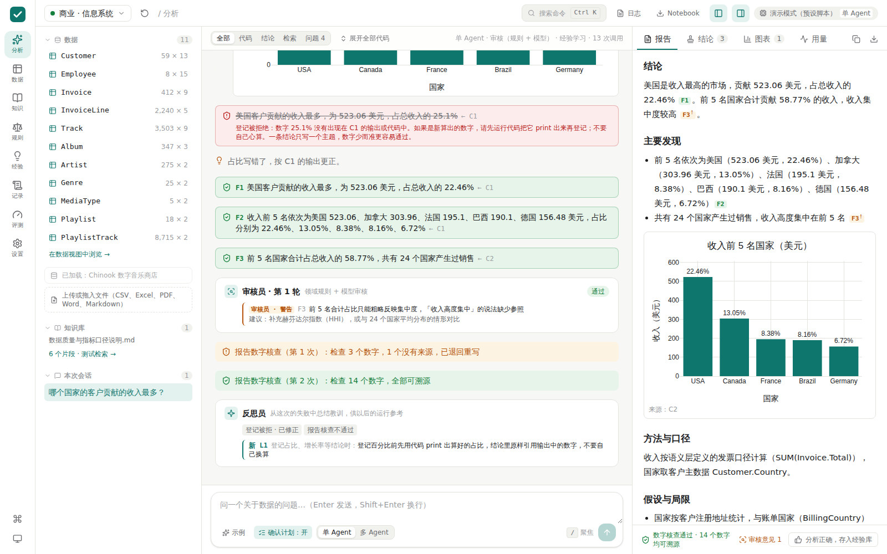

# 多 Agent 设计

> 三期均已实现。每一期都有对应的评测方法，用数据证明效果，而不是堆概念。

## 一句话

**调度器（代码）按计划逐步派出上下文独立的分析员，由审核员按领域规则检查结论，运行结束后由反思员从失败中总结经验。**

范式名称：Orchestrator-Workers（调度者-执行者）+ Reflection（审核）+ Reflexion（经验反思）。

## 为什么要拆

单 Agent 的问题来自一次真实运行（攀枝花 2015–2025 逐日降雨，qwen3.8-flash）：

| 现象 | 数据 | 根本原因 |
|---|---|---|
| Token 消耗大 | 26 次调用，输入共 37.7 万 Token，最后一次单次输入 2.8 万 | 每一步都要重发之前全部的代码和输出 |
| 步数不够 | 跑满 24 步上限，被强制结束 | 一个循环包办全部 6 个计划步骤 |
| 方法问题无人检查 | 11 年样本外推百年一遇；"预测"实为气候平均 | 只有数字核查，没有方法核查 |
| 同类错误反复出现 | 路径、plotly 用法、引号错误 | 每次运行从零开始，不记得上次的教训 |

## 总体结构

```
用户提问
   │
调度器（Python 代码，流程写死，不由模型决定）
   │
   ├─ ① 规划者    拆成 2–6 步，写明每步要交付的结论                         已有
   │
   ├─ ② 分析员 × N 每步一个，全新上下文，提交结构化结果                     第 1 期 ✓
   │
   ├─ ③ 审核员    领域规则检查（程序）+ 方法逻辑检查（模型），不通过退回一次   第 2 期 ✓
   │
   ├─ ④ 撰写者    写报告 + 数字核查                                       已有
   │
   └─ ⑤ 反思员    从失败中总结教训 → 经验库 → 下次运行使用                  第 3 期 ✓

共享"黑板"：Jupyter 内核变量 · 结论登记表 · 追溯日志
```

**关键原则：流程由代码控制。** 不让多个模型自由对话（AutoGen 群聊式），因为那样结果不可预测、难以调试、难以评测。每个角色都是同一个模型，区别只在提示词、可用工具和能看到的上下文。

## 第 1 期：分析员子代理（已实现）

### 机制

| 机制 | 做法 | 借鉴自 | 代码 |
|---|---|---|---|
| 全新上下文 | 每个分析员只拿到一张"交接单"，看不到前面步骤的代码和对话 | DeepSeek Harness 子代理的 `fresh` 模式 | `orchestrator.py` `_execute_multi()` |
| 交接单 | 整体计划、本步任务、前面各步的总结和登记的结论、内核里已有的变量 | — | `prompts.py` `handoff()` |
| 结构化提交 | 分析员调用 `submit_step` 交回 `status / summary / variables / notes`；没登记结论就不能标记完成 | DeepSeek Harness 子代理的 `outputSchema` | `tools/builtin.py` `submit_step()` |
| 变量交接 | 调度器自动列出内核里新建的变量（名字、类型、形状），写进交接单 | — | `session.py` `kernel_variables()` |
| 轮数预算 | 每个分析员最多 10 轮（可配置），剩 3 轮时提醒收尾；超出预算时收下已登记的结论，标记"部分完成"，继续下一步 | — | `orchestrator.py` `_react()` |
| 输出溢出 | 超长输出存到 `outputs/C5.txt`，模型只看到开头和文件位置，需要时再读 | DeepSeek Harness 的 spill 存储 | `tools/builtin.py` `_cell_result()` |

### 为什么能省 Token

前面步骤写过的代码和打印的输出不再发给后面的分析员：结果都留在内核变量里，交接单只说明"有个变量叫 `ann`，是 11×14 的 DataFrame"。每个分析员的上下文从几千 Token 起步，而不是越滚越大。

### 已知取舍

- **步骤按顺序执行**，不并行：所有分析员共用一个内核，并行会互相覆盖变量
- **计划里的依赖关系暂未使用**：交接单包含前面所有步骤的总结（它们都很短），不按依赖筛选
- **总结可能不准**：后续分析员只能相信前面的总结。缓解办法：总结里的关键数字要与已登记结论一致，结论原文也一并交接；第 2 期的审核员会再检查

### 怎么用

- 网页：输入框下方选择"多 Agent"
- 命令行：`proven ask "..." --mode multi`
- 默认模式：`.env` 中 `PROVEN_MODE=multi`

### 怎么证明效果

```powershell
proven eval --pack water --mode single
proven eval --pack water --mode multi
```

对比两份报告的正确率、平均调用次数、总 Token、耗时。再用同一个攀枝花问题各跑一次，用 `proven logs` 对比失败次数和各步骤用量。

## 第 2 期：审核员（已实现）



> 截图：分析员忘了把流量从 cfs 换算成 m³/s，算出径流系数 15.76。规则 W001 和模型审核员同时拦下，退回同一个分析员；分析员补上换算，用 F2 替换 F1，第 2 轮复审通过。

### 两层检查

| 层 | 谁来检查 | 检查什么 | 成本 | 代码 |
|---|---|---|---|---|
| **规则检查** | 程序 | 领域规则：取值范围、方法适用条件、文字与数字一致 | 不调用模型，结果确定 | `rules.py`、`packs/*/rules.yaml` |
| **模型审核** | 模型（审核员角色，全新上下文） | 规则写不出来的方法问题：口径、单位换算、相关当因果、以偏概全 | 每次审核 1 次模型调用 | `agent/review.py`、`prompts.py` `REVIEW` |

数字是否抄对，早在登记时就由证据检查保证了（第 0 层），审核员不再核对数字，只看**方法和表述**。

规则由领域专家编写，放在领域包的 `rules.yaml` 里，格式见 [domain-rules-template.md](domain-rules-template.md)。现在的规则是初稿：通用 5 条（统计表述、占比）、水利 7 条、商业 3 条，依据中标注"待核实"的需要作者对照规范原文确认。这部分是项目作者的原创内容。

### 流程

```
分析员提交（多 Agent：每一步；单 Agent：整个执行结束后）
   │
   ├─ 规则检查：对本步每条结论逐条跑规则
   ├─ 模型审核：只看结论 + 证据代码和输出 + 规则已发现的问题，输出 JSON
   │
   ├─ 有"错误"？── 是 → 带着审核意见退回同一个分析员（它的上下文还在），最多重做一次
   │                     分析员重新计算，用 record_finding(replaces="F1") 替换旧结论
   │                     → 第 2 轮审核（不再退回）
   │
   └─ 最终意见交给撰写者：
        警告 → 写进报告的"假设与局限"
        仍未解决的错误 → 也写进局限，相关结论不能作为确定结论
```

| 机制 | 做法 | 代码 |
|---|---|---|
| 规则触发 | 结论中出现触发词才检查；写了豁免词（如"不显著""仅供参考"）就跳过 | `rules.py` `evaluate()` |
| 取值归属 | "径流系数与干旱指数的相关系数为 -0.75"：-0.75 属于相关系数，不属于径流系数。数字和触发词之间出现另一个指标名、比较词（大于、超过）或计数词（个、年）时不检查 | `rules.py` `_values_after()` |
| 事实抽取 | p 值、相关系数、样本长度、重现期、Cs/Cv 有内置的识别模式（如"19 年资料""2000–2018 年""n=19""百年一遇""P=1%"），按结论 → 证据 → 同次分析的其他结论的顺序查找 | `rules.py` `FACTS`、`find_fact()` |
| 替换结论 | 被替换的结论标记为 `retracted`，不再进入报告和核查；报告引用它会被当成未知引用 | `findings.py` `retract()`、`tools/builtin.py` `record_finding()` |
| 退回同一个分析员 | 重做时接着原来的对话，而不是重新派一个，这样它知道自己之前做了什么 | `orchestrator.py` `_execute_multi()` |
| 审核失败不影响分析 | 模型审核返回的不是 JSON，或调用出错时，只保留规则检查结果，分析继续 | `orchestrator.py` `_review()` |

### 怎么用

- 默认开启（`PROVEN_REVIEW=full`）。只想用规则、不多花 Token：`PROVEN_REVIEW=rules`；关闭：`off`
- 网页：设置 → 运行参数 → 审核员；"审核规则"页面查看规则并运行陷阱测试
- 命令行：`proven rules --pack water` 列出规则并检查格式

### 怎么证明效果

**1. 陷阱测试**（`packs/*/evals/review_cases.yaml`）：一批故意写错的结论（方法用错、结论与数字矛盾、违反物理约束），加一批正确结论，统计**拦截率**和**误拦率**。

```powershell
proven review-eval --pack water          # 只测规则，不调用模型，1 秒内完成
proven review-eval --pack water --llm    # 加上模型审核，评估规则覆盖不到的用例
```

当前结果（只用规则）：水利 27 条用例、商业 13 条，拦截率 100%，误拦率 0%。

这个数字**不能直接拿去说明效果**：用例和规则是同一个人一起写的，100% 只说明规则按设计工作。写用例的过程中确实发现了 6 处误拦（例如上面"取值归属"那一条），修正后才到 0%，这正是陷阱测试的用处。可信的评估需要：由别人编写用例，或者从真实运行日志里收集模型实际犯过的错误。

**2. 端到端对比**：同一组评测题分别关闭和开启审核员，比较正确率和 Token。

```powershell
proven eval --pack water --mode multi --review off
proven eval --pack water --mode multi --review full
```

### 已知取舍

- **规则靠字面匹配**：结论换一种说法（"径流比"）就可能不触发。缓解：触发词列表可以加；模型审核兜底
- **按结论逐条检查**：跨结论的矛盾（F1 说上升、F3 说下降）只能靠模型审核发现
- **审核员和分析员是同一个模型**：可能对自己的错误不敏感。将来可以给审核员配一个不同的模型
- **只退回一次**：防止无限循环和 Token 失控；仍未解决的问题如实写进报告，而不是假装解决了

## 第 3 期：反思员与经验进化（已实现）



> 截图：这次运行有一条结论登记被拒（占比写成了 25.1%，代码输出是 22.46%），报告第一次核查也没通过。反思员读了这两条失败，总结出 L1；之后的运行会把 L1 放进提示词。

### 这不是强化学习

强化学习需要训练模型权重。本项目通过 API 调用模型，不改权重。这里用的是**不训练模型的经验进化**，思路来自 Reflexion（Shinn et al., 2023）：把失败转成文字教训，下次放进提示词。

### 一次运行里发生了什么

```
运行开始
   └─ 从经验库挑出最相关的教训（最多 5 条）放进提示词；多 Agent 模式下每个分析员都能看到
...（规划、执行、审核、报告）...
运行结束
   ├─ 程序从追溯日志里收集失败：代码报错、结论登记被拒、报告核查不通过、审核发现的问题、轮数用完
   │    每条失败有一个"签名"，如 code:AttributeError:…、review:W001
   │    如果同一次运行里后来改对了，也把改对的写法附上
   ├─ 记账：这次用到的教训，对应的失败有没有再出现？
   └─ 反思员（模型，一次调用）：读失败记录和已有教训，写出 0–3 条新教训，或者指出哪条已有教训又被印证了
```

| 机制 | 做法 | 代码 |
|---|---|---|
| 失败由程序收集 | 不让模型读整份日志，只给它失败事件和随后的修正 | `agent/reflector.py` `collect_failures()` |
| 教训要通用 | 提示词要求写"做什么 / 不要做什么"和适用场景；含有本次结果数字的教训直接丢弃（防止把答案当经验） | `reflector.py` `leaks_result()` |
| 去重 | 和已有教训足够相似（分词后 Dice ≥ 0.6），或反思员指明重复，就合并计数，不新增 | `lessons.py` `similar()`、`reinforce()` |
| 适用范围 | `all`：运行环境、库和工具的用法，所有领域包都用；`pack`：只用于本领域 | `lessons.py` `select()` |
| 挑选 | 与问题的相关度 + 历史效果得分 + 被印证的次数 | `lessons.py` `select()` |
| 记账与淘汰 | 用过之后同样的失败没再出现记"有效"，又出现记"无效"；用过 3 次以上、得分低于 0.3 自动停用。手写的教训默认固定，不会被停用 | `lessons.py` `credit()` |
| 停用的不再复活 | 反思员再次写出已停用的教训时只计数、不恢复；并且在提示词里告诉它"这条用过但无效，换一种更具体的做法" | `lessons.py` `reinforce()`、`orchestrator.py` `reflect()` |

### 奖励信号从哪来

不需要人工标注，都是程序已经能判定的：

| 信号 | 来源 |
|---|---|
| 代码报错 | 沙箱 |
| 结论登记被拒 | 证据检查 |
| 报告核查不通过 | 数字核查 |
| 审核不通过 | 第 2 期审核员（规则的警告也算：如"没写样本长度"是值得养成的习惯） |
| 评测题答错 | 评测集（只在经验进化实验的训练集上使用） |

### 怎么用

- 默认开启（`PROVEN_LESSONS=learn`）：有失败的运行结束时多一次模型调用，没有失败就不调用
- `use`：只参考已有教训、不再学习（适合评测和对外演示，结果更稳定）；`off`：完全不用
- 网页："经验库 → 教训"查看、手写、固定、停用、删除；每条教训可以点开来源运行回放；设置 → 运行参数 → 经验
- 命令行：`proven lessons --pack water`
- `proven eval` 默认不使用教训（`--lessons off`），避免以前的评测运行影响单/多 Agent 的对比

### 怎么证明效果

```powershell
proven evolve --pack water
```

| 阶段 | 题目 | 经验库 |
|---|---|---|
| 第 0 轮 | 测试集 | 不用（基线） |
| 训练第 1 遍 | 训练集 | 学习：每题结束后反思，答错也算一次失败 |
| 第 1 轮 | 测试集 | 只读 |
| 训练第 2 遍 | 训练集 | 学习：已有教训被印证或被淘汰 |
| 第 2 轮 | 测试集 | 只读 |

- **训练集和测试集分开**：教训只从训练题的运行中提取，测试题只读不学，避免"在测试题上学习测试题"。按题型交替划分，也可以在 `questions.yaml` 里给题目写 `split: train` 或 `split: test`
- **独立工作区**：实验在 `workspace/evals/evolve/<时间>-<领域>/` 里运行，从空的经验库开始，不影响日常使用的教训
- **看什么**：测试集上的正确率，以及各类失败次数（代码报错、登记被拒、审核问题……）。失败次数比正确率更敏感：教训首先减少的是弯路，不一定直接改变答案对错
- **成本**：约为一次完整评测的 3 倍（测试集 3 遍 + 训练集 2 遍，外加反思调用）

### 已知取舍

- **记账是弱证据**：失败没再出现，可能只是这次没遇到相应场景，不一定是教训起了作用。所以单次结果不决定去留，要用过 3 次以上才会停用
- **签名匹配是近似的**：同一类错误换了报错信息可能匹配不上
- **题目太少**：每个领域包十几道题，一两题的差异在随机波动范围内。要得出可靠结论需要更多题目，或者同一配置多跑几次
- **教训会占用提示词**：最多放 5 条，每条一句话，约 200–400 Token

### 将来

追溯日志里积累的运行轨迹（每一步的输入、动作、结果、对错）是现成的训练数据。如果将来有 GPU 和开源模型，可以用来做监督微调或强化学习。这是"未来工作"，不在本项目范围内。

## 参考

- DeepSeek Harness：子代理（fresh / fork、outputSchema、maxDepth）、上下文压缩、spill 存储、Agent Teams 任务图 — https://github.com/deepseek-ai/deepseek-harness
- Reflexion: Language Agents with Verbal Reinforcement Learning（Shinn et al., 2023）
- CodeAct: Executable Code Actions Elicit Better LLM Agents（Wang et al., 2024）
- 微软 TaskWeaver：Planner + 有状态代码解释器
